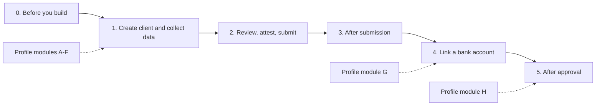

# Embedded Payments UX Atlas: Build Your Own Onboarding and Linked Account UX

This atlas is an index. It points to the Payments Developer Portal guides, the recipes in this repository, and live examples; it does not replace them. Confirm the requirements for your program with your J.P. Morgan representative.

For a guided version, open the [interactive UX Atlas][demo-atlas]. Answer the profile questions, explore the journey map, and copy a checklist for your team.

## Who This Is For

Platform teams that build their **own** onboarding and link-bank-account screens on the Embedded Payments APIs. If you would rather not build every screen, see [Other Ways to Integrate](#other-ways-to-integrate).

Use the atlas in two passes:

1. **Profile your platform.** Answer the [profile questions](#1-profile-your-platform). Every "yes" adds data to collect or states to handle.
2. **Walk the journey.** Follow the [journey map](#2-walk-the-journey) stage by stage. Each stage lists what to build and where the guidance lives.

Each entry links to one or more of these resource types:

| Label         | What it is                                                                    |
| ------------- | ----------------------------------------------------------------------------- |
| **Guide**     | Payments Developer Portal how-to. The normative API documentation.            |
| **API**       | API reference.                                                                |
| **Recipe**    | UX recipe in this repository. Suggested patterns, not requirements.           |
| **Storybook** | Live UI states built on the same APIs with our React components.              |
| **Demo**      | Page in this repository's showcase app.                                       |
| **Test**      | Sandbox scenario or magic values from the [Testing Catalog][testing-catalog]. |

Storybook uses our components, but the states, validation rules, and edge cases it shows apply to any UI built on the same APIs. Use it as a reference even if you never install the components.

## Journey at a Glance

## 1. Profile Your Platform

Ask these questions before you design screens. Most platforms start with US small businesses that are privately held. Each question below identifies participants whose data collection differs from that baseline.

| #   | Question                                                                                        | If yes, read                                                 |
| --- | ----------------------------------------------------------------------------------------------- | ------------------------------------------------------------ |
| A   | Do you onboard sole proprietorships?                                                            | [A. Sole proprietorships](#a-sole-proprietorships)           |
| B   | Do you onboard publicly traded companies or their subsidiaries?                                 | [B. Publicly traded companies](#b-publicly-traded-companies) |
| C   | Do businesses have controllers or beneficial owners who live outside the US?                    | [C. Non-US individuals](#c-non-us-individuals)               |
| D   | Do businesses have intermediary (indirect) ownership?                                           | [D. Indirect ownership](#d-indirect-ownership)               |
| E   | Do you onboard nonprofits, government entities, partnerships, or unincorporated associations?   | [E. Other legal forms](#e-other-legal-forms)                 |
| F   | Do you already hold business or owner data, for example from existing customers or a migration? | [F. Prefilled data](#f-prefilled-data)                       |
| G   | Will clients link an external bank account?                                                     | [Stage 4](#stage-4-link-a-bank-account)                      |
| H   | Will clients update their details after approval?                                               | [Stage 5](#stage-5-after-approval)                           |

Every platform also needs to handle **additional document requests** after submission. See [Stage 3](#stage-3-after-submission).

### A. Sole Proprietorships

The individual is the business, but it is still onboarded as a business.

- Collect business details for the individual: a DBA name if they operate under one, and a tax ID. Use the business's EIN if it has one, otherwise the owner's SSN.
- Give the individual both the `CONTROLLER` and `BENEFICIAL_OWNER` roles.
- The business is formed in the US, and the owner's country of residence can only be the US.
- Don't offer publicly traded options to a sole proprietorship.

| Type      | Resource                                                                                                                                          |
| --------- | ------------------------------------------------------------------------------------------------------------------------------------------------- |
| Guide     | [Create a client profile][pdp-create-client], [Onboarding reference][pdp-onboarding-reference], [Core concepts: test personas][pdp-core-concepts] |
| Recipe    | [Digital Onboarding Recipe: Steps 3 & 4, owners and decision makers][recipe-onboarding-owners]                                                    |
| Storybook | [Gateway: select sole proprietorship][sb-gateway-soleprop], [Sole proprietorship: no PTC option][sb-ptc-soleprop]                                 |

### B. Publicly Traded Companies

- Ask for the business's legal form, then whether it is directly traded, a subsidiary of a publicly traded parent, or neither.
- Send both `isSubsidiary` and `publiclyTraded` for these businesses. For a subsidiary, send the listing of the publicly traded parent that owns 51% or more of it.
- Owner and controller requirements depend on where the company or its parent is listed. Adjust the rest of the journey to match.

| Type      | Resource                                                                                                                             |
| --------- | ------------------------------------------------------------------------------------------------------------------------------------ |
| Guide     | [Onboard publicly traded companies][pdp-ptc]                                                                                         |
| Recipe    | [Publicly Traded Companies UI Recipe][recipe-ptc]                                                                                    |
| Storybook | [Fresh client][sb-ptc-fresh], [Primary listing, directly traded][sb-ptc-primary], [Subsidiary of a traded parent][sb-ptc-subsidiary] |

### C. Non-US Individuals

- Let users change the **country of residence** for controllers and beneficial owners. Sole proprietorships are the exception, see [A](#a-sole-proprietorships).
- Collect the address for that country. State and postal code rules vary: HK, SG, AE, and QA need special handling of the state and postal code fields.
- Offer government ID types that fit the issuing country (`individualIds[].idType` and `issuer`). The Portal's field reference lists `SSN` and `ITIN`, so confirm which ID types your program accepts for non-US individuals.

| Type      | Resource                                                                                                                                                                                                             |
| --------- | -------------------------------------------------------------------------------------------------------------------------------------------------------------------------------------------------------------------- |
| Guide     | [Onboarding reference][pdp-onboarding-reference]                                                                                                                                                                     |
| Recipe    | [Digital Onboarding Flow Recipe: Address Reference Data][recipe-flow-address], [Connect to API Q&A: UAT address validation][qa-address]                                                                              |
| Storybook | [State picker and postal code][sb-address-state-postal], [No state, no postal code][sb-address-none], [Mismatched address country][sb-bad-address-country], all [Address countries][sb-address-state-postal] stories |

### D. Indirect Ownership

- Ask whether any businesses own part of the client (`entitiesInOwnership`).
- If so, collect every individual and every intermediary business that owns 25% or more of the client, directly or indirectly.
- Create intermediaries as `ORGANIZATION` parties with the `INTERMEDIARY_OWNER` role. Link each layer to its immediate parent with `parentPartyId`, and set `natureOfOwnership`.
- Confirm with your J.P. Morgan representative which sub-products, such as `LIMITED_DDA_PAYMENTS`, require the full ownership chain.

| Type      | Resource                                                                                                               |
| --------- | ---------------------------------------------------------------------------------------------------------------------- |
| Guide     | [Collect indirect ownership information][pdp-indirect]                                                                 |
| Recipe    | [IndirectOwnership functional requirements][ref-indirect-fr] (written for our component, describes the rules)          |
| Storybook | [Onboarding with indirect ownership enabled][sb-indirect-enabled], [Ownership structure editor][sb-indirect-component] |

### E. Other Legal Forms

Besides LLCs, corporations, and sole proprietorships, the API accepts nonprofits (`NON_PROFIT_CORPORATION`), government entities (`GOVERNMENT_ENTITY`), unincorporated associations (`UNINCORPORATED_ASSOCIATION`), and partnerships. Check the API reference for the current list of organization types and any deprecated values.

Confirm the required fields, owners, and documents for these forms with your J.P. Morgan representative.

| Type  | Resource                                                        |
| ----- | --------------------------------------------------------------- |
| Guide | [Onboarding reference][pdp-onboarding-reference]                |
| API   | [Onboarding API reference][api-onboarding] (`OrganizationType`) |

### F. Prefilled Data

If you already hold data about a participant, decide:

- which data you send when you create the client. You can start with minimum data and add the rest over time;
- which prefilled fields the participant may change and which are locked;
- whether participants see only what is still missing. The client's `outstanding` object lists missing items, and each party's `validationResponse` lists its missing fields.

| Type      | Resource                                                                                                                                                                           |
| --------- | ---------------------------------------------------------------------------------------------------------------------------------------------------------------------------------- |
| Guide     | [Create a client profile][pdp-create-client]                                                                                                                                       |
| Storybook | [Prepopulated client][sb-prepopulated], [Read-only fields when populated][sb-readonly-populated], [Always locked][sb-readonly-locked], [Only missing fields][sb-delta-operational] |

After approval, changes go through update requests instead. See [Stage 5](#stage-5-after-approval).

## 2. Walk the Journey

### Stage 0: Before You Build

- Create a developer account and a project with the Embedded Payments API enabled, and complete the certificate exchange for the Client Test Environment.
- Learn the core concepts: clients, parties, and roles. The test personas cover a limited liability company and a sole proprietor.
- Learn the sandbox magic values so you can trigger each state on demand.
- Subscribe to webhooks early. Most status screens depend on them.

| Type   | Resource                                                                                                          |
| ------ | ----------------------------------------------------------------------------------------------------------------- |
| Guide  | [Get started][pdp-get-started], [Core concepts][pdp-core-concepts], [Notifications][pdp-notifications]            |
| API    | [Authentication][api-auth], [mTLS with digital signature][api-mtls], [Error codes][api-error-codes]               |
| Recipe | [Connect to API Q&A][qa], [Accelerating API Implementation][accelerating] with the [Arazzo workflow spec][arazzo] |
| Test   | [Testing Catalog: prerequisites][testing-catalog], [Magic values][testing-magic]                                  |

### Stage 1: Create Client and Collect Data

- Create the client with `POST /clients`. You can start with minimum data (the business, one controller, and the product) and add the rest over time.
- Add parties: a controller, every beneficial owner with 25% or more, and any decision makers.
- Collect business identity, industry (category and type, or a NAICS code), and contact details. Only mailing addresses may be P.O. boxes, private mailboxes, virtual offices, or registered agent addresses.
- Render the due diligence questions listed in the client's `outstanding` object. Ask follow-up sub-questions only when the parent answer requires them.
- Apply the [profile modules](#1-profile-your-platform) that matched your platform.

| Type      | Resource                                                                                                                                                                                                                                           |
| --------- | -------------------------------------------------------------------------------------------------------------------------------------------------------------------------------------------------------------------------------------------------- |
| Guide     | [Create a client profile][pdp-create-client], [Onboard to multiple products][pdp-multi-product], [Present onboarding questions][pdp-questions], [Business classification recommendation][pdp-naics], [Industry descriptor reference][pdp-industry] |
| API       | [Onboarding API reference][api-onboarding]                                                                                                                                                                                                         |
| Recipe    | [Digital Onboarding Recipe][recipe-onboarding], [Due diligence questions][recipe-onboarding-questions], [NAICS Recommendation Guide][naics], [Date Parsing Guide][dates], [Important Date Selector Recipe][date-selector]                          |
| Storybook | Interactive workflows: [registered business][sb-gateway-llc], [owners][sb-owners], [operational details][sb-operational]; [Conditional sub-question][sb-question-conditional]; [Industry recommendation][sb-naics]                                 |
| Test      | [Testing Catalog: Guide 1, Onboard Clients][testing-onboard]                                                                                                                                                                                       |

### Stage 2: Review, Attest, Submit

- Show a review of everything collected, and clear every item in the client's `outstanding` object.
- Present the terms and the attestation documents, record the attestation, then submit with `POST /clients/{id}/verifications`.

| Type   | Resource                                                                                                                                        |
| ------ | ----------------------------------------------------------------------------------------------------------------------------------------------- |
| Guide  | [Display terms and conditions][pdp-terms], [Present attestations][pdp-attestations], [Complete onboarding][pdp-complete]                        |
| Recipe | [Digital Onboarding Recipe: Step 6, Review and Attestation][recipe-onboarding-review], [Step 7, Trigger Verification][recipe-onboarding-verify] |

### Stage 3: After Submission

- Design a screen for each client status: `REVIEW_IN_PROGRESS`, `INFORMATION_REQUESTED`, `APPROVED`, and `DECLINED`. Approved clients can later become `SUSPENDED` or `TERMINATED`.
- **Additional documents.** When documents are needed, the client moves from `REVIEW_IN_PROGRESS` to `INFORMATION_REQUESTED`, and `outstanding.documentRequestIds` lists the requests. A request can target the client or a related party, and one requirement can accept several document types.
- Accept PNG, JPEG, and PDF files up to 2 MB. One document type can take several files, such as the front and back of an ID. Submit each request with `POST /document-requests/{id}/submit`; its status moves from `ACTIVE` to `CLOSED`.
- Drive status changes from webhooks and poll only as a fallback. Respond with a `200` within three seconds, ignore duplicate `eventId` values, and expect events out of order.

| Type      | Resource                                                                                                                                                                                                                                                                                       |
| --------- | ---------------------------------------------------------------------------------------------------------------------------------------------------------------------------------------------------------------------------------------------------------------------------------------------- |
| Guide     | [Upload documents][pdp-upload-docs], [Notification payloads][pdp-notification-payloads]                                                                                                                                                                                                        |
| API       | [Documents API reference][api-documents]                                                                                                                                                                                                                                                       |
| Recipe    | [Document Upload Form Guide][recipe-docs], [Connect to API Q&A: document requests][qa-docs], [Webhook Integration Recipe: onboarding UI][recipe-webhook-onboarding]                                                                                                                            |
| Storybook | Client states: [review in progress][sb-state-review], [information requested][sb-state-info], [approved][sb-state-approved], [declined][sb-state-declined]; [Documents requested][sb-docs-requested], [several documents per requirement][sb-docs-multi], [upload error][sb-docs-upload-error] |
| Demo      | [Webhook Explorer][demo-webhooks]                                                                                                                                                                                                                                                              |
| Test      | [Testing Catalog: document request scenarios 2-4, approval and decline scenarios 5-6][testing-onboard]                                                                                                                                                                                         |

### Stage 4: Link a Bank Account

Decide these before you design the screens:

1. **When.** Right after submission, or only after approval?
2. **How many.** One account, or several? A client with a `LIMITED_DDA` account needs at least one active linked account to receive settlement.
3. **Payment methods.** ACH only, or ACH, wire, and RTP? Always send ACH routing details, because microdeposits use ACH. Wire also needs the holder's address. You can add wire and RTP later.
4. **Account holder.** Ask who owns the external account: the business or an individual. Don't let a preselected default stand in for that answer. Reference the owner's `partyId`, or send a name that exactly matches the onboarded business or one of its owners.

Linked accounts must be US bank accounts with ABA routing numbers.

Then design for every status: `PENDING`, `MICRODEPOSITS_INITIATED`, `READY_FOR_VALIDATION`, `ACTIVE`, `REJECTED`, and `INACTIVE`.

- Most accounts are validated immediately. Otherwise two microdeposits arrive within 3-5 business days and the account becomes `READY_FOR_VALIDATION`. The client then has 20 business days and 3 attempts to confirm the amounts. After 3 failed attempts, the account is `REJECTED`.
- To remove an account, set its status to `INACTIVE`.
- Handle API errors such as an invalid routing number or a duplicate account.

| Type      | Resource                                                                                                                                                                                                                                                                                                                                                                                                                                                                                       |
| --------- | ---------------------------------------------------------------------------------------------------------------------------------------------------------------------------------------------------------------------------------------------------------------------------------------------------------------------------------------------------------------------------------------------------------------------------------------------------------------------------------------------- |
| Guide     | [Add a linked account][pdp-linked], [Pay out to a linked account][pdp-payout-linked]                                                                                                                                                                                                                                                                                                                                                                                                           |
| API       | [Recipients API reference][api-recipients]                                                                                                                                                                                                                                                                                                                                                                                                                                                     |
| Recipe    | [Linked Accounts API Workflow Recipe][recipe-linked], [Webhook Integration Recipe: linked account events][recipe-webhook-recipients]                                                                                                                                                                                                                                                                                                                                                           |
| Storybook | When: [enabled client statuses][sb-la-enabled]. How many: [multiple accounts][sb-la-multi]. Methods: [ACH only][sb-la-ach], [ACH, wire, RTP][sb-la-multi-method]. Statuses: [microdeposits initiated][sb-la-md], [only rejected accounts][sb-la-rejected], [all statuses][sb-law-statuses]. Verification: [failed][sb-law-failed], [too many attempts][sb-law-max], [RTP unavailable at bank][sb-law-rtp]. Errors: [invalid routing number][sb-la-error-routing], [duplicate][sb-la-error-dup] |
| Test      | [Testing Catalog: Guide 4, Link an External Bank Account][testing-linked]                                                                                                                                                                                                                                                                                                                                                                                                                      |

### Stage 5: After Approval

- Let approved clients update their details through update requests. This is available for clients in the US and Canada with supported legal entity types.
- Send only the changed fields with `PATCH /parties/{partyId}`, or add a party with `POST /parties`. Changes collect in one draft request per client (`updateRequest` with status `NEW`). Supported changes: legal name or DBA, address, and adding, removing, or modifying related parties.
- Upload any requested documents and complete the attestations, then submit with `POST /clients/{id}/verifications`. Outcomes are `APPROVED`, `DECLINED`, or `TERMINATED`, for example when an information request goes unanswered for 30 days. Approved data appears in responses 24 to 48 hours after approval.
- Show the approved values next to the proposed changes until the request completes.
- Add sub-products to an approved client when needed.

| Type      | Resource                                                                                                        |
| --------- | --------------------------------------------------------------------------------------------------------------- |
| Guide     | [Update a party][pdp-update-party], [Onboard to multiple products][pdp-multi-product]                           |
| Recipe    | [Approved Client Maintenance Recipe][recipe-maintenance]                                                        |
| Storybook | [Approved Client Maintenance overview][sb-maintenance], [maintenance request statuses][sb-maintenance-statuses] |

## Other Ways to Integrate

| Option                       | When to choose it                                    | Start here                                                                                                                                                                                                       |
| ---------------------------- | ---------------------------------------------------- | ---------------------------------------------------------------------------------------------------------------------------------------------------------------------------------------------------------------- |
| Embedded components (React)  | You want our screens inside your React app.          | [Components README][components-readme], [OnboardingFlow docs][sb-onboarding-docs], [LinkedAccountWidget docs][sb-linked-docs], [Showcase: onboarding][demo-onboarding], [Showcase: linked accounts][demo-linked] |
| Partially hosted UI          | You want J.P. Morgan to host the onboarding screens. | [Partially Hosted UI Integration Guide][hosted-guide], [Partially hosted demo][demo-hosted]                                                                                                                      |
| Compare integration patterns | You're still choosing.                               | [Payments Flow Simulator][demo-flow-simulator]                                                                                                                                                                   |

## Resource Index

Recipes and guides in this repository, grouped by who they help most.

| Resource                                                 | Best for                                    |
| -------------------------------------------------------- | ------------------------------------------- |
| [Digital Onboarding Recipe][recipe-onboarding]           | Your own UX: onboarding API steps           |
| [Publicly Traded Companies UI Recipe][recipe-ptc]        | Your own UX: PTC journeys                   |
| [Document Upload Form Guide][recipe-docs]                | Your own UX: document requests              |
| [Linked Accounts API Workflow Recipe][recipe-linked]     | Your own UX: linked accounts                |
| [Webhook Integration Recipe][recipe-webhook]             | Your own UX: status and event screens       |
| [Approved Client Maintenance Recipe][recipe-maintenance] | Your own UX: post-approval updates          |
| [NAICS Recommendation Guide][naics]                      | Your own UX: industry selection             |
| [Connect to API Q&A][qa]                                 | Everyone: access, certificates, sandbox     |
| [Testing Catalog][testing-catalog]                       | Everyone: sandbox scenarios                 |
| [Embedded Finance Patterns][patterns]                    | Everyone: UI pattern catalog                |
| [Date Parsing Guide][dates]                              | Everyone: date handling                     |
| [Accelerating API Implementation][accelerating]          | Everyone: spec-driven and LLM-assisted work |
| [Digital Onboarding Flow Recipe][recipe-flow]            | Component users: how OnboardingFlow works   |
| [Partially Hosted UI Integration Guide][hosted-guide]    | Hosted UI integrators                       |

[pdp-get-started]: https://developer.payments.jpmorgan.com/docs/embedded-finance-solutions/embedded-payments/get-started
[pdp-core-concepts]: https://developer.payments.jpmorgan.com/docs/embedded-finance-solutions/embedded-payments/core-concepts
[pdp-create-client]: https://developer.payments.jpmorgan.com/docs/embedded-finance-solutions/embedded-payments/capabilities/onboard-a-client/how-to/create-a-client-profile
[pdp-onboarding-reference]: https://developer.payments.jpmorgan.com/docs/embedded-finance-solutions/embedded-payments/capabilities/onboard-a-client/how-to/onboarding-reference
[pdp-multi-product]: https://developer.payments.jpmorgan.com/docs/embedded-finance-solutions/embedded-payments/capabilities/onboard-a-client/how-to/onboard-to-sub-products-and-multiple-products
[pdp-questions]: https://developer.payments.jpmorgan.com/docs/embedded-finance-solutions/embedded-payments/capabilities/onboard-a-client/how-to/present-onboarding-questions
[pdp-naics]: https://developer.payments.jpmorgan.com/docs/embedded-finance-solutions/embedded-payments/capabilities/onboard-a-client/how-to/business-classification-recommendation
[pdp-industry]: https://developer.payments.jpmorgan.com/docs/embedded-finance-solutions/embedded-payments/capabilities/onboard-a-client/how-to/industry-descriptor-reference
[pdp-ptc]: https://developer.payments.jpmorgan.com/docs/embedded-finance-solutions/embedded-payments/capabilities/onboard-a-client/how-to/publicly-traded-companies
[pdp-indirect]: https://developer.payments.jpmorgan.com/docs/embedded-finance-solutions/embedded-payments/capabilities/onboard-a-client/how-to/indirect-ownership
[pdp-terms]: https://developer.payments.jpmorgan.com/docs/embedded-finance-solutions/embedded-payments/capabilities/onboard-a-client/how-to/display-terms-conditions
[pdp-attestations]: https://developer.payments.jpmorgan.com/docs/embedded-finance-solutions/embedded-payments/capabilities/onboard-a-client/how-to/present-attestations
[pdp-complete]: https://developer.payments.jpmorgan.com/docs/embedded-finance-solutions/embedded-payments/capabilities/onboard-a-client/how-to/complete-onboarding
[pdp-upload-docs]: https://developer.payments.jpmorgan.com/docs/embedded-finance-solutions/embedded-payments/capabilities/onboard-a-client/how-to/upload-documents
[pdp-update-party]: https://developer.payments.jpmorgan.com/docs/embedded-finance-solutions/embedded-payments/capabilities/onboard-a-client/how-to/update-party
[pdp-linked]: https://developer.payments.jpmorgan.com/docs/embedded-finance-solutions/embedded-payments/capabilities/external-accounts/add-linked-account
[pdp-payout-linked]: https://developer.payments.jpmorgan.com/docs/embedded-finance-solutions/embedded-payments/capabilities/transactions/payouts/how-to/linked-account
[pdp-notifications]: https://developer.payments.jpmorgan.com/docs/embedded-finance-solutions/embedded-payments/capabilities/notification-subscriptions/how-to/notifications
[pdp-notification-payloads]: https://developer.payments.jpmorgan.com/docs/embedded-finance-solutions/embedded-payments/capabilities/notification-subscriptions/how-to/notification-payloads
[api-onboarding]: https://developer.payments.jpmorgan.com/api/embedded-finance-solutions/embedded-payments/onboarding
[api-documents]: https://developer.payments.jpmorgan.com/api/embedded-finance-solutions/embedded-payments/embedded-payments/documents
[api-recipients]: https://developer.payments.jpmorgan.com/api/embedded-finance-solutions/embedded-payments/embedded-payments/recipients
[api-error-codes]: https://developer.payments.jpmorgan.com/api/embedded-finance-solutions/embedded-payments/error-codes
[api-auth]: https://developer.payments.jpmorgan.com/api/authentication
[api-mtls]: https://developer.payments.jpmorgan.com/api/mtls-with-digital-signature
[recipe-onboarding]: https://github.com/jpmorgan-payments/embedded-finance/blob/main/embedded-components/docs/DIGITAL_ONBOARDING_RECIPE.md
[recipe-onboarding-owners]: https://github.com/jpmorgan-payments/embedded-finance/blob/main/embedded-components/docs/DIGITAL_ONBOARDING_RECIPE.md#steps-3--4-business-owners-and-decision-makers
[recipe-onboarding-questions]: https://github.com/jpmorgan-payments/embedded-finance/blob/main/embedded-components/docs/DIGITAL_ONBOARDING_RECIPE.md#step-5-due-diligence-additional-questions
[recipe-onboarding-review]: https://github.com/jpmorgan-payments/embedded-finance/blob/main/embedded-components/docs/DIGITAL_ONBOARDING_RECIPE.md#step-6-review-and-attestation
[recipe-onboarding-verify]: https://github.com/jpmorgan-payments/embedded-finance/blob/main/embedded-components/docs/DIGITAL_ONBOARDING_RECIPE.md#step-7-trigger-verification
[recipe-flow]: https://github.com/jpmorgan-payments/embedded-finance/blob/main/embedded-components/docs/DIGITAL_ONBOARDING_FLOW_RECIPE.md
[recipe-flow-address]: https://github.com/jpmorgan-payments/embedded-finance/blob/main/embedded-components/docs/DIGITAL_ONBOARDING_FLOW_RECIPE.md#address-reference-data
[recipe-ptc]: https://github.com/jpmorgan-payments/embedded-finance/blob/main/embedded-components/docs/PUBLICLY_TRADED_COMPANIES_RECIPE.md
[recipe-docs]: https://github.com/jpmorgan-payments/embedded-finance/blob/main/embedded-components/docs/DOCS_UPLOAD_FORM_RECIPE.md
[recipe-linked]: https://github.com/jpmorgan-payments/embedded-finance/blob/main/embedded-components/docs/LINKED_ACCOUNTS_RECIPE.md
[recipe-webhook]: https://github.com/jpmorgan-payments/embedded-finance/blob/main/embedded-components/docs/WEBHOOK_INTEGRATION_RECIPE.md
[recipe-webhook-onboarding]: https://github.com/jpmorgan-payments/embedded-finance/blob/main/embedded-components/docs/WEBHOOK_INTEGRATION_RECIPE.md#1-client-facing-onboarding-ui
[recipe-webhook-recipients]: https://github.com/jpmorgan-payments/embedded-finance/blob/main/embedded-components/docs/WEBHOOK_INTEGRATION_RECIPE.md#recipient-linked-account-events--ux-recommendations
[recipe-maintenance]: https://github.com/jpmorgan-payments/embedded-finance/blob/main/embedded-components/docs/APPROVED_CLIENT_MAINTENANCE_RECIPE.md
[naics]: https://github.com/jpmorgan-payments/embedded-finance/blob/main/embedded-components/docs/NAICS_RECOMMENDATION_IMPLEMENTATION_GUIDE.md
[qa]: https://github.com/jpmorgan-payments/embedded-finance/blob/main/embedded-components/docs/CONNECT_TO_API_QA.md
[qa-address]: https://github.com/jpmorgan-payments/embedded-finance/blob/main/embedded-components/docs/CONNECT_TO_API_QA.md#uat-address-validation
[qa-docs]: https://github.com/jpmorgan-payments/embedded-finance/blob/main/embedded-components/docs/CONNECT_TO_API_QA.md#document-requests
[testing-catalog]: https://github.com/jpmorgan-payments/embedded-finance/blob/main/embedded-components/docs/TESTING_CATALOG.md
[testing-magic]: https://github.com/jpmorgan-payments/embedded-finance/blob/main/embedded-components/docs/TESTING_CATALOG.md#magic-values-for-sandbox-testing
[testing-onboard]: https://github.com/jpmorgan-payments/embedded-finance/blob/main/embedded-components/docs/TESTING_CATALOG.md#guide-1-onboard-clients
[testing-linked]: https://github.com/jpmorgan-payments/embedded-finance/blob/main/embedded-components/docs/TESTING_CATALOG.md#guide-4-link-an-external-bank-account
[patterns]: https://github.com/jpmorgan-payments/embedded-finance/blob/main/embedded-components/docs/EMBEDDED_FINANCE_PATTERNS.md
[dates]: https://github.com/jpmorgan-payments/embedded-finance/blob/main/embedded-components/docs/DATE_PARSING_GUIDE.md
[date-selector]: https://github.com/jpmorgan-payments/embedded-finance/blob/main/embedded-components/docs/IMPORTANT_DATE_SELECTOR_RECIPE.md
[accelerating]: https://github.com/jpmorgan-payments/embedded-finance/blob/main/embedded-components/docs/ACCELERATING_API_IMPLEMENTATION.md
[arazzo]: https://github.com/jpmorgan-payments/embedded-finance/blob/main/embedded-components/docs/arazzo_specification.yaml
[hosted-guide]: https://github.com/jpmorgan-payments/embedded-finance/blob/main/embedded-components/docs/partially-hosted/PARTIALLY_HOSTED_UI_INTEGRATION_GUIDE.md
[components-readme]: https://github.com/jpmorgan-payments/embedded-finance/blob/main/embedded-components/README.md
[ref-indirect-fr]: https://github.com/jpmorgan-payments/embedded-finance/blob/main/embedded-components/src/core/IndirectOwnership/FUNCTIONAL_REQUIREMENTS.md
[sb-onboarding-docs]: https://storybook.embedded-finance-dev.com/?path=/docs/core-onboardingflow--docs
[sb-linked-docs]: https://storybook.embedded-finance-dev.com/?path=/docs/core-linkedaccountwidget--docs
[sb-gateway-llc]: https://storybook.embedded-finance-dev.com/?path=/story/core-onboardingflow-interactive-workflows--1-a-gateway-select-llc
[sb-gateway-soleprop]: https://storybook.embedded-finance-dev.com/?path=/story/core-onboardingflow-interactive-workflows--1-b-gateway-select-sole-proprietorship
[sb-owners]: https://storybook.embedded-finance-dev.com/?path=/story/core-onboardingflow-interactive-workflows--4-owners-complete-section
[sb-operational]: https://storybook.embedded-finance-dev.com/?path=/story/core-onboardingflow-interactive-workflows--5-operational-details
[sb-question-conditional]: https://storybook.embedded-finance-dev.com/?path=/story/core-onboardingflow-prepopulated-client-questions--conditional-sub-question
[sb-naics]: https://storybook.embedded-finance-dev.com/?path=/story/core-onboardingflow-naics-industry--ai-single-recommendation
[sb-ptc-fresh]: https://storybook.embedded-finance-dev.com/?path=/story/core-onboardingflow-publicly-traded-companies--fresh-client
[sb-ptc-primary]: https://storybook.embedded-finance-dev.com/?path=/story/core-onboardingflow-publicly-traded-companies--primary-ptc-nyse
[sb-ptc-subsidiary]: https://storybook.embedded-finance-dev.com/?path=/story/core-onboardingflow-publicly-traded-companies--primary-subsidiary-nasdaq
[sb-ptc-soleprop]: https://storybook.embedded-finance-dev.com/?path=/story/core-onboardingflow-publicly-traded-companies--sole-proprietorship-no-ptc
[sb-address-state-postal]: https://storybook.embedded-finance-dev.com/?path=/story/core-onboardingflow-address-countries--state-picker-and-postal-code
[sb-address-none]: https://storybook.embedded-finance-dev.com/?path=/story/core-onboardingflow-address-countries--no-state-no-postal-code
[sb-bad-address-country]: https://storybook.embedded-finance-dev.com/?path=/story/core-onboardingflow-bad-api-data--mismatched-address-country
[sb-indirect-enabled]: https://storybook.embedded-finance-dev.com/?path=/story/core-onboardingflow-indirect-ownership--enabled
[sb-indirect-component]: https://storybook.embedded-finance-dev.com/?path=/story/beta-indirectownership--default
[sb-prepopulated]: https://storybook.embedded-finance-dev.com/?path=/story/core-onboardingflow-prepopulated-client--operator-80-prepopulated
[sb-readonly-populated]: https://storybook.embedded-finance-dev.com/?path=/story/core-onboardingflow-readonly-fields--when-populated
[sb-readonly-locked]: https://storybook.embedded-finance-dev.com/?path=/story/core-onboardingflow-readonly-fields--always-locked
[sb-delta-operational]: https://storybook.embedded-finance-dev.com/?path=/story/core-onboardingflow-delta-mode--operational-details-only
[sb-state-review]: https://storybook.embedded-finance-dev.com/?path=/story/core-onboardingflow-client-states--review-in-progress
[sb-state-info]: https://storybook.embedded-finance-dev.com/?path=/story/core-onboardingflow-client-states--information-requested
[sb-state-approved]: https://storybook.embedded-finance-dev.com/?path=/story/core-onboardingflow-client-states--approved
[sb-state-declined]: https://storybook.embedded-finance-dev.com/?path=/story/core-onboardingflow-client-states--declined
[sb-docs-requested]: https://storybook.embedded-finance-dev.com/?path=/story/core-onboardingflow-documentupload--docs-requested
[sb-docs-multi]: https://storybook.embedded-finance-dev.com/?path=/story/core-onboardingflow-documentupload--docs-requested-multiple-docs-in-requirement
[sb-docs-upload-error]: https://storybook.embedded-finance-dev.com/?path=/story/core-onboardingflow-documentupload--error-on-upload-document
[sb-la-enabled]: https://storybook.embedded-finance-dev.com/?path=/story/core-onboardingflow-linked-account-enabled-statuses--multiple-statuses
[sb-la-multi]: https://storybook.embedded-finance-dev.com/?path=/story/core-onboardingflow-linked-account-multi-account--allow-multiple-accounts
[sb-la-ach]: https://storybook.embedded-finance-dev.com/?path=/story/core-onboardingflow-linked-account-payment-methods--link-step-default-ach-only
[sb-la-multi-method]: https://storybook.embedded-finance-dev.com/?path=/story/core-onboardingflow-linked-account-payment-methods--link-step-ach-wire-rtp-multi
[sb-la-md]: https://storybook.embedded-finance-dev.com/?path=/story/core-onboardingflow-linked-account-client-states--approved-with-linked-account-microdeposits-initiated
[sb-la-rejected]: https://storybook.embedded-finance-dev.com/?path=/story/core-onboardingflow-linked-account-client-states--approved-with-only-rejected-accounts
[sb-la-error-routing]: https://storybook.embedded-finance-dev.com/?path=/story/core-onboardingflow-linked-account-api-errors--error-400-invalid-routing
[sb-la-error-dup]: https://storybook.embedded-finance-dev.com/?path=/story/core-onboardingflow-linked-account-api-errors--error-409-duplicate
[sb-law-statuses]: https://storybook.embedded-finance-dev.com/?path=/story/core-linkedaccountwidget-account-statuses--mixed-statuses
[sb-law-failed]: https://storybook.embedded-finance-dev.com/?path=/story/core-linkedaccountwidget-interactive-workflows--failed-verification
[sb-law-max]: https://storybook.embedded-finance-dev.com/?path=/story/core-linkedaccountwidget-interactive-workflows--max-attempts-exceeded
[sb-law-rtp]: https://storybook.embedded-finance-dev.com/?path=/story/core-linkedaccountwidget-interactive-workflows--rtp-unavailable-at-bank
[sb-maintenance]: https://storybook.embedded-finance-dev.com/?path=/docs/draft-approvedclientmaintenance--docs
[sb-maintenance-statuses]: https://storybook.embedded-finance-dev.com/?path=/story/draft-approvedclientmaintenance-maintenance-request-statuses--submitted
[demo-atlas]: https://embedded-finance-dev.com/ux-atlas
[demo-onboarding]: https://embedded-finance-dev.com/sellsense-demo?fullscreen=true&component=onboarding&theme=Empty
[demo-linked]: https://embedded-finance-dev.com/sellsense-demo?fullscreen=true&component=linked-accounts&theme=Empty
[demo-hosted]: https://embedded-finance-dev.com/partially-hosted-demo
[demo-webhooks]: https://embedded-finance-dev.com/webhook-explorer
[demo-flow-simulator]: https://embedded-finance-dev.com/payments-flow-simulator
